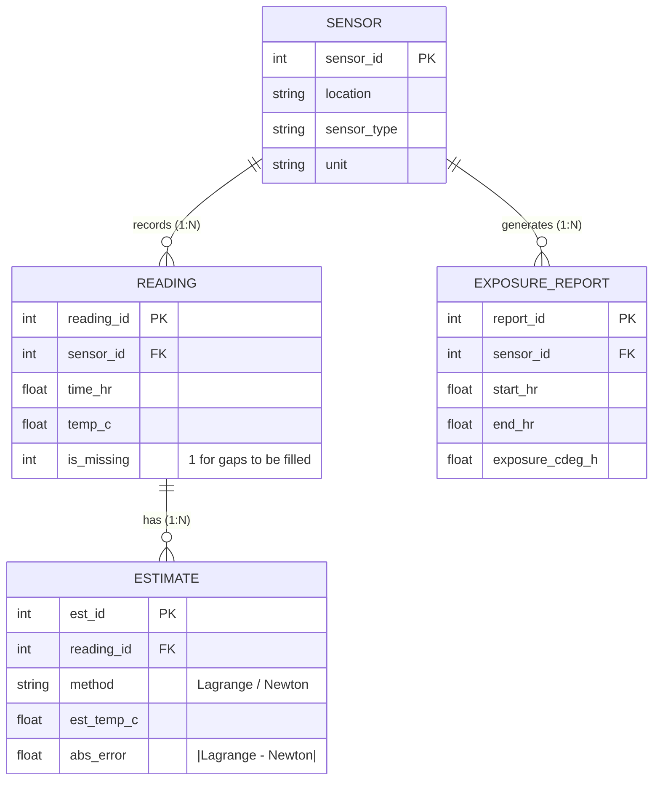

# SMART TEMPERATURE DATA ANALYSER

[](#)
[](#)
[](#)
[](#)
[](#)

An academic and industrial IoT numerical analysis system designed to estimate missing discrete sensor readings and calculate cumulative thermal exposure using relational database management, from-scratch numerical interpolation (Lagrange & Newton), and numerical quadrature (Trapezoidal & Simpson 1/3 rules).

---

## 👥 Project Team (Section D G-3)

| Name | Enrollment Number | Role |
| :--- | :--- | :--- |
| **Vaneesha Singh** | `21818002725` | Algorithm Design & Literature Survey |
| **Anisha Dubey** | `22018002725` | Relational Schema & DBMS Modeling |
| **Amritanshu Mishra** | `22218002725` | Numerical Differentiation & Integration |
| **Sumit Chourasia** | `22618002725` | ESP32 Firmware & Wokwi Circuit Simulation |
| **Milind Shukla** | `22718002725` | Full-Stack Flask Backend & Dashboard Development |

---

## 📌 1. Problem Definition

Temperature loggers record at discrete time instants. Sensor dropouts, power interruptions, and packet collisions leave gaps in the timeline. A plain discrete sequence does not directly reveal the total thermal history a temperature-sensitive product, vaccine, or crop was exposed to:

1. **Missing Readings**: Given measured discrete pairs $(t_i, T_i)$, estimate the temperature $T(t^*)$ at an unrecorded instant $t^*$.
2. **Cumulative Exposure**: From the completed continuous profile, calculate total thermal exposure:
   $$E = \int_{t_{\text{start}}}^{t_{\text{end}}} T(t) \, dt \quad \left[\text{in } ^\circ\text{C}\cdot\text{h}\right]$$

*Example Scenario:* Discrete readings arrive every 2 hours from 06:00 to 18:00. The 11:00 reading was dropped, requiring estimation of $T(11:00)$ and calculation of total $^\circ\text{C}\cdot\text{h}$ for the day.

---

## 🎯 2. Objectives

1. Store discrete time-temperature readings in a structured relational database.
2. Detect timeline gaps and estimate missing values using **Lagrange polynomial interpolation**.
3. Cross-check every interpolated estimate with the **Newton divided-difference** nested form.
4. Compute cumulative thermal exposure using both the **Trapezoidal** and **Simpson 1/3** quadrature rules.
5. Validate numerical accuracy with a **hold-out validation test** and present analytical graphs.

---

## 🗄️ 3. Relational Database Design (Slide 10 ER Model)

The SQLite database (`smart_temperature_db.db`) implements the exact 4-table relational entity-relationship structure:



* **`READING`**: Rows with `is_missing = 1` represent gaps to be filled.
* **`ESTIMATE`**: Stores Lagrange and Newton estimations alongside the cross-check absolute difference (`abs_error`).
* **`EXPOSURE_REPORT`**: Stores integrated thermal exposure for the target analysis window.

---

## 🔬 4. Mathematical Methodology (Slides 14 & 15)

To prevent polynomial instability (**Runge's Phenomenon**), interpolation is performed using a **local window of the 4 nearest nodes** (cubic interpolation):

### A. Lagrange Interpolation
$$P(x) = \sum_{i=0}^n y_i L_i(x), \quad L_i(x) = \prod_{j \ne i} \frac{x - x_j}{x_i - x_j}$$

### B. Newton Divided Difference Form
$$P(x) = f[x_0] + f[x_0, x_1](x - x_0) + f[x_0, x_1, x_2](x - x_0)(x - x_1) + \dots$$
Evaluated efficiently via Horner's nested scheme.

### Worked Example: Estimating $T(11:00)$
* Nearest 4 nodes: $t \in \{08:00, 10:00, 12:00, 14:00\}$
* Measured temperatures: $\{27.5^\circ\text{C}, 31.2^\circ\text{C}, 34.8^\circ\text{C}, 35.6^\circ\text{C}\}$
* Divided Difference Table:
  * **Order 1**: `['1.85000', '1.80000', '0.40000']`
  * **Order 2**: `['-0.01250', '-0.35000']`
  * **Order 3**: `['-0.05625']`
* Evaluation at $t = 11$:
  $$P(11) = 27.5 + 1.85(3) - 0.0125(3)(1) - 0.05625(3)(1)(-1) = \mathbf{33.18125^\circ\text{C}} \approx \mathbf{33.18^\circ\text{C}}$$
* **Cross-check**: $\text{Lagrange} \equiv \text{Newton} \implies \text{Error} = 0.0000^\circ\text{C}$.

### Hold-Out Validation Check
* Hidden node: $t = 12:00$ (actual $= 34.800^\circ\text{C}$).
* Estimated from remaining nodes $\{8, 10, 14, 16\}$:
  $$\text{Estimate} = \mathbf{34.433^\circ\text{C}} \implies \text{Error} = 34.800 - 34.433 = \mathbf{0.367^\circ\text{C}} \quad (\approx 1.1\%)$$

---

## 📈 5. Numerical Integration Results (Slides 16 & 19)

### Quadrature Formulations:
* **Trapezoidal Rule**: $E \approx \frac{h}{2} \left[T_0 + 2\sum T_{\text{interior}} + T_n\right]$
* **Simpson's 1/3 Rule**: $E \approx \frac{h}{3} \left[T_0 + 4\sum T_{\text{odd}} + 2\sum T_{\text{even}} + T_n\right]$

| Integration Method | Time Spacing ($h$) | Computed Exposure ($E$) |
| :--- | :--- | :--- |
| **Trapezoidal Rule** | $h = 2\text{ h}$ (7 measured readings) | **$377.80^\circ\text{C}\cdot\text{h}$** |
| **Simpson's 1/3 Rule** | $h = 2\text{ h}$ (7 measured readings) | **$379.07^\circ\text{C}\cdot\text{h}$** |
| **Simpson's 1/3 Rule (Hourly)** | $h = 1\text{ h}$ (13 points with estimates) | **$378.88^\circ\text{C}\cdot\text{h}$** |
| **Mean Temperature** | $378.88 / 12\text{ h}$ | **$31.57^\circ\text{C}$** |

*The two rules agree within **0.34%** ($1.27^\circ\text{C}\cdot\text{h}$ difference), confirming high numerical stability.*

---

## 💻 6. Implementation Modules (`analyser.py`)

As specified in Slide 17, `analyser.py` implements:

* `lagrange(xs, ys, x)`: Computes Lagrange interpolation estimate.
* `divided_differences(xs, ys)`: Builds the full Newton divided-difference table.
* `newton(xs, ys, x)`: Evaluates nested Newton polynomial.
* `nearest_four(xs, ys, x)`: Selects 4 optimal nodes to suppress Runge's oscillation.
* `trapezoid(xs, ys)`: Computes trapezoidal integral over discrete intervals.
* `simpson(xs, ys)`: Computes parabolic Simpson 1/3 quadrature.

### Terminal Verification Output (Slide 21):
```bash
python analyser.py
```
```text
=== SMART TEMPERATURE DATA ANALYSER ===

[1] Missing reading at t = 11 h (nodes: [8, 10, 12, 14])
    Lagrange            : 33.1812 C
    Newton divided diff : 33.1812 C

[2] Divided-difference table
    order 1 : ['1.85000', '1.80000', '0.40000']
    order 2 : ['-0.01250', '-0.35000']
    order 3 : ['-0.05625']

[3] Validation (hide t = 12, estimate from 8,10,14,16)
    estimate 34.433 C | actual 34.800 C | error 0.367 C

[5] Cumulative temperature exposure, 06:00 -> 18:00
    Trapezoidal (2 h data)  : 377.80 C.h
    Simpson 1/3 (2 h data)  : 379.07 C.h
    Simpson 1/3 (hourly)    : 378.88 C.h
    Mean temperature        : 31.57 C
```

---

## 🌐 7. Full-Stack Web Application & Wokwi IoT Studio

The project includes a complete Flask backend (`server.py`) and single-file dark dashboard (`index.html`):

* **Tab 1: 📊 Real-Time Analytics**: Live telemetry chart, rolling Z-score outlier filtering, finite difference $dT/dt$, and 20-step Least Squares forecast.
* **Tab 2: 📚 DBMS Academic Analysis**: Interactive browser view of the 4 relational tables, worked example $T(11:00)$, divided-difference table, and Slide 19 reconstructed curves.
* **Tab 3: 🛠️ Wokwi Hardware Studio**: 1-click circuit schematic, pinout map, and link to [wokwi.com/projects/new/esp32](https://wokwi.com/projects/new/esp32).

### Running the Stack:
```bash
# Terminal 1: Run the Core DBMS Analysis & Generate Plots
python analyser.py

# Terminal 2: Launch the Flask Backend & Web Application
python server.py

# Terminal 3: Start the Wokwi ESP32 Virtual Hardware Streamer
python wokwi_bridge_simulator.py
```
Access the application at **`http://localhost:5000`**.

---

## 📚 8. References (Slide 24)

1. R. L. Burden and J. D. Faires, *Numerical Analysis*, Cengage Learning.
2. S. C. Chapra and R. P. Canale, *Numerical Methods for Engineers*, McGraw-Hill Education.
3. K. E. Atkinson, *An Introduction to Numerical Analysis*, John Wiley & Sons.
4. B. S. Grewal, *Numerical Methods in Engineering and Science*, Khanna Publishers.
5. W. H. Press et al., *Numerical Recipes: The Art of Scientific Computing*, Cambridge University Press.
6. R. Elmasri and S. B. Navathe, *Fundamentals of Database Systems*, Pearson.
7. NumPy documentation: `https://numpy.org/doc/`
8. SQLite documentation: `https://www.sqlite.org/docs.html`
