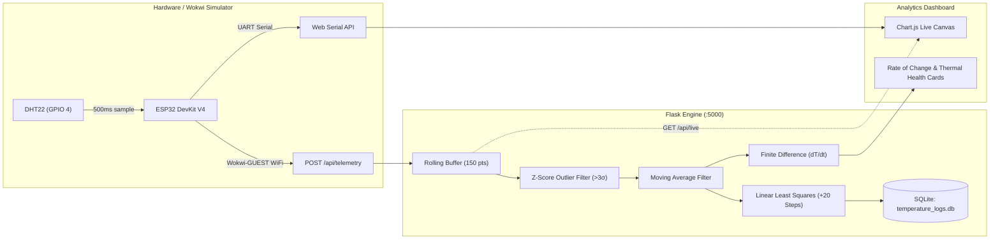

# ⚡ Smart Temperature Analyzer & IoT Telemetry Platform

An end-to-end embedded IoT telemetry and computational signal processing system. Features **ESP32 + DHT22** virtual circuit simulation ([Wokwi](https://wokwi.com/projects/new/esp32)), a high-performance **Flask REST Backend** with **SQLite** persistence, and a modern **Dark-Themed Analytics Dashboard** (Vanilla JS + Chart.js).

All numerical filters, derivative calculations, and regression algorithms are built **entirely from scratch** (zero Pandas, SciPy, or scikit-learn).

---

## 🌟 Key Features

* **ESP32 + DHT22 Dual-Mode Firmware (`sketch.ino`)**:
  * 500 ms non-blocking temperature sampling via `millis()`.
  * Emits raw CSV telemetry (`<time_ms>,<temp_c>`) to high-speed UART (115200 baud).
  * Auto-connects to Wokwi virtual WiFi (`Wokwi-GUEST`) and pushes HTTP JSON packets to `/api/telemetry`.
* **Zero-Library Computational Math Engine**:
  * **Rolling Z-Score Outlier Filter**: Rejects anomalous hardware glitch spikes ($|z| > 3.0\sigma$).
  * **Moving Average Filter**: Zero-phase centered noise smoothing.
  * **Central Finite Difference**: Instantaneous rate of temperature change ($dT/dt$).
  * **Linear Least Squares Regression**: 20-step predictive trendline based on the last 50 samples.
  * **Trapezoidal Rule Integration**: Cumulative thermal exposure calculation ($\int T dt$).
* **Full-Stack Analytics Dashboard (`index.html`)**:
  * Dark-themed analytics workstation with real-time Chart.js scatter/line/forecast rendering.
  * Web Serial API integration (`navigator.serial`) for 1-click browser hardware connection.
  * Thermal safety state indicators (`NOMINAL` vs `WARNING: HIGH TEMP`).
  * Dedicated **🛠️ Wokwi Studio** tab with 1-click circuit schematic and copyable project files.
* **Streamlit Interactive Visualizer (`app.py`)**:
  * Standalone exploratory dashboard with tuning sliders for $\alpha$, Z-threshold, and forecast horizon.

---

## 🏗️ Architecture



---

## 🚀 Quick Start Guide

### 1. Clone & Install Dependencies
```bash
git clone https://github.com/Milind04-png/smart-temperature-analyzer.git
cd smart-temperature-analyzer
pip install flask flask-cors streamlit matplotlib pyserial
```

### 2. Launch the Full-Stack Application
```bash
# Terminal 1: Start the Flask Backend (Port 5000)
python server.py

# Terminal 2: Start the Live ESP32 Telemetry Simulator (500ms pulse)
python wokwi_bridge_simulator.py
```
Open your browser to **http://localhost:5000** to view the live dashboard!

### 3. (Optional) Run with Wokwi Online Simulator
1. Open [wokwi.com/projects/new/esp32](https://wokwi.com/projects/new/esp32).
2. Paste `sketch.ino` into the code editor.
3. Replace `diagram.json` with the repository's `diagram.json`.
4. In the Library Manager tab, add `DHT sensor library`.
5. Press **Play ▶** to see live serial and WiFi telemetry!

### 4. (Optional) Launch the Streamlit Analytical App
```bash
streamlit run app.py
```

---

## 📊 API Reference

| Endpoint | Method | Description |
| :--- | :--- | :--- |
| `GET /` | `GET` | Serves the main dark-theme dashboard |
| `POST /api/telemetry` | `POST` | Ingests live sensor readings (`{"time": ms, "temperature": °C}`) |
| `GET /api/live` | `GET` | Returns rolling 150-sample telemetry buffer & real-time forecast |
| `GET /api/data` | `GET` | Executes 500-sample diurnal batch simulation with outlier scrubbing |
| `GET /api/history` | `GET` | Fetches the last 10 prediction snapshots from SQLite |
| `GET /api/wokwi-project` | `GET` | Returns complete firmware and diagram configuration for Wokwi |

---

## 📝 License
MIT License. Free to use, modify, and distribute.
